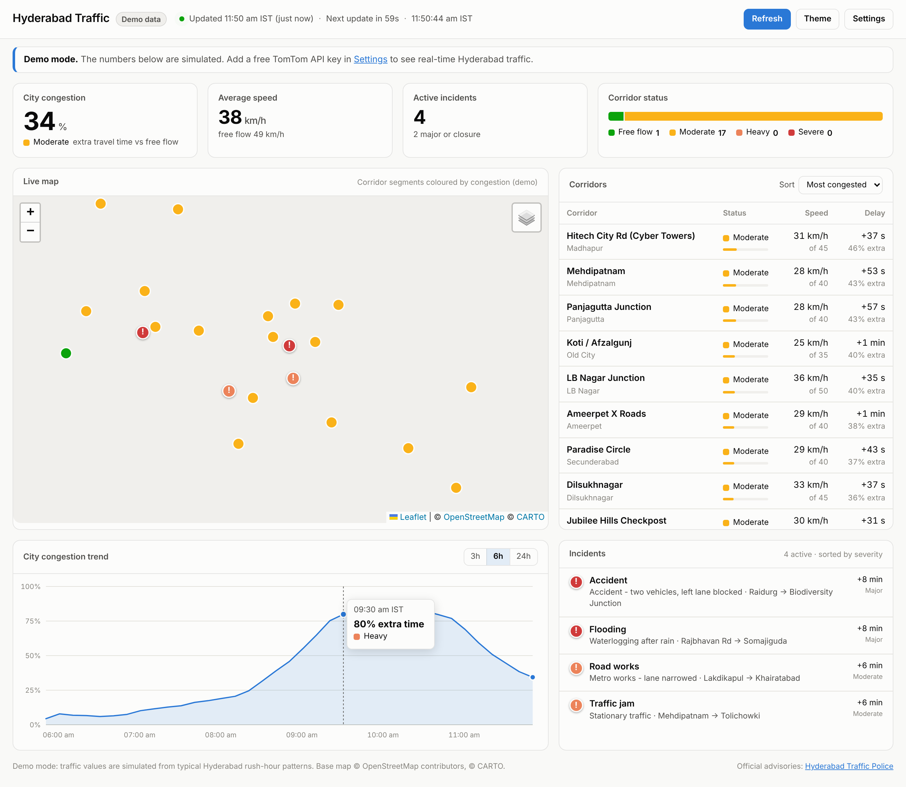

# Traffic_Hyderabad

Live status of Hyderabad traffic: an auto-refreshing dashboard. It monitors 18 key corridors (Hitech City, Gachibowli, Panjagutta, Ameerpet, Mehdipatnam, LB Nagar, Uppal, ORR and others) and shows city-wide congestion, active incidents and a congestion trend on an interactive map.



## Features

- **City congestion index**: extra travel time across the monitored corridors compared with free-flow conditions (similar to the TomTom Traffic Index).
- **Live map** (Leaflet): TomTom map with its live flow layer for all roads, the monitored corridors coloured by congestion, and incident markers. Road closures are on a separate layer, hidden by default (turn it on from the layers button).
- **Commute alerts**: phone notifications (Telegram or ntfy) when your evening commute is heavy. See [Commute alerts](#commute-alerts-phone-notifications).
- **My commute**: live travel time between your home and work in both directions, with the usual time for this hour, the empty-road time, up to three route options (named by the main roads they use) drawn on the map, and a link to compare in Google Maps.
- **Corridor table**: current speed vs free-flow speed, delay and status (Free flow / Moderate / Heavy / Severe / Closed), sortable. Click a row to fly to it on the map.
- **Incidents feed**: accidents, jams, road works, closures and flooding, sorted by severity.
- **Congestion trend** for 3h, 6h or 24h, stored in your browser and built up as the page refreshes.
- Auto-refresh with a countdown. Refresh pauses while the tab is hidden, to save API quota.
- Light and dark mode, and a mobile layout.
- **Demo mode** with simulated rush-hour data, used when no API key is set, so the dashboard works out of the box.

## Live data: get a free TomTom API key

Real-time data comes from the [TomTom Traffic API](https://developer.tomtom.com/traffic-api/documentation/product-information/introduction) (Flow Segment Data, Incident Details and Traffic Flow tiles).

1. Create a free account at <https://developer.tomtom.com/> and copy your API key.
2. Open the dashboard and click **Settings**.
3. Paste the key and click **Save**.

The key is stored only in your browser's `localStorage`. To deploy with a built-in key, set `tomtomKey` in [`js/config.js`](js/config.js), **and restrict the key to your domain** in the TomTom developer portal, because it will be visible to anyone who opens the page.

### Quota

Each refresh makes one Flow request per corridor (18) plus one Incidents request, plus 2 routing requests if a commute is set up. The free tier allows about 2,500 non-tile requests a day:

| Refresh interval | Requests per hour | Viewing time per day on free tier |
|---|---|---|
| 1 min | 1,140 | ~2 h |
| 5 min (default) | 228 | ~11 h |
| 15 min | 76 | ~33 h |

Map and traffic tiles count against a separate, larger tile quota.

## Set up your commute

Open **Settings → My commute** and enter **Home** and **Work**, either as place names (for example `Cyber Towers, Hitech City`) or as exact coordinates (`17.45040, 78.38100`). Place names are looked up with TomTom Search, so they need an API key. Hover the **H** and **W** pins on the map to check that the right places were found; if a place is off, paste coordinates instead (in Google Maps, long-press a spot to copy them).

Your places are saved only in your browser and are never written to this repository. The commute adds 2 routing requests to each refresh.

## Commute alerts (phone notifications)

A scheduled GitHub Action (`.github/workflows/commute-alerts.yml`) checks the office → home route at **4:25, 4:40 and 4:55 PM IST, Monday to Friday**. If traffic is heavy, it sends a message to your phone. The message has the current travel time compared with the usual time, the route options, predicted times if you leave at 5:00, 5:30 or 6:00 PM, and any accidents or jams on your route. The dashboard doesn't need to be open.

### Setup

1. In the repo, go to **Settings → Secrets and variables → Actions → New repository secret** and add:
   - `TOMTOM_KEY`: your TomTom API key
   - `HOME_COORDS`: e.g. `17.36160, 78.47470`
   - `WORK_COORDS`: e.g. `17.45040, 78.38100`
2. Pick where messages go (one or both):
   - **Telegram:** in Telegram, open **@BotFather**, send `/newbot` and follow the steps. Save the token it gives you as the secret `TELEGRAM_BOT_TOKEN`. Then open your new bot and send it any message (e.g. "hi"). The first test run (step 3) replies with your chat ID; save it as the secret `TELEGRAM_CHAT_ID`.
   - **ntfy** (no account needed): install the **ntfy** app, tap **+**, and subscribe to a hard-to-guess topic name such as `hyd-traffic-k39xq72m`. Save that name as the secret `NTFY_TOPIC`. Anyone who knows the name can read the messages, so keep it random.
3. Test it: go to **Actions → Commute alerts → Run workflow**. A test run sends a message even when traffic is normal.

Secrets stay private even though the repository is public, and the script never writes places or routes to the (public) Actions logs.

### Options

- **Morning alerts** (6:25 to 6:55 AM, for a 7:00 AM start): remove the `#` from the two morning `cron` lines in the workflow file.
- **Sensitivity:** alerts fire when the trip takes 50% or more longer than on empty roads (the dashboard's *Heavy* level). To change this, add a repository *variable* (not a secret) `ALERT_EXTRA_PCT`, e.g. `70` for fewer alerts.
- **Departure times:** variables `EVENING_DEPART` (default `17:00`) and `MORNING_DEPART` (default `07:00`) set the times used for the "if you leave at" predictions.

GitHub can start scheduled runs a few minutes late; runs that start after 5:30 PM are skipped. GitHub also pauses schedules in repositories with no activity for 60 days; re-enable them from the Actions tab.

Each check uses 1 routing request, plus 4 more when it alerts. That's at most 15 a day.

## Run locally

The site is static (plain HTML, CSS and JS, with no build step).

```bash
cd Traffic_Hyderabad
python3 -m http.server 8000
```

Then open <http://localhost:8000>. Opening `index.html` directly also works.

## Deploy

A GitHub Actions workflow (`.github/workflows/pages.yml`) publishes the site to GitHub Pages on every push to `main`. Enable it once under **Settings → Pages → Source: GitHub Actions**.

## Customise

All tunable settings live in [`js/config.js`](js/config.js):

- `corridors`: add or remove monitored locations (`lat`/`lon` is any point on the road; TomTom snaps it to the nearest segment).
- `refreshSeconds`, `historyHours`, map centre and zoom, and the incident bounding box.

Status thresholds (extra travel time vs free flow): Free flow < 20%, Moderate 20–50%, Heavy 50–100%, Severe ≥ 100%.

## Project layout

```
index.html          page structure
css/styles.css      styles and light/dark theme tokens
js/config.js        corridors and settings
js/data.js          TomTom API client and demo-data simulator
js/app.js           UI rendering, map, chart and refresh loop
alerts/             scheduled commute alert script (GitHub Actions)
```

## Data and attribution

- Traffic data and map (live mode) © TomTom. Demo-mode map © OpenStreetMap contributors.
- For official advisories and diversions, see the [Hyderabad Traffic Police](https://www.htp.gov.in/).
- Demo-mode values are simulated and are not real traffic conditions.
